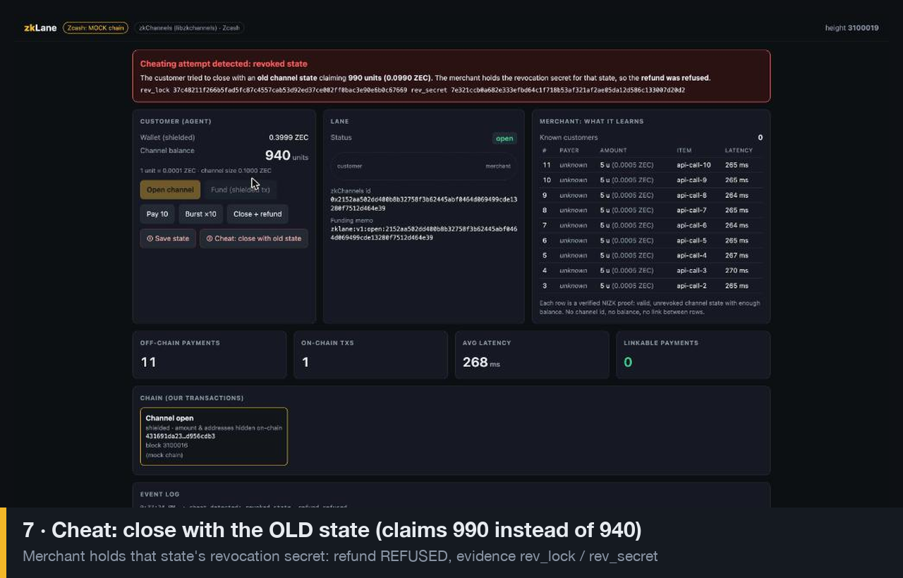

# zkLane: private payment channels on Zcash

**One shielded Zcash transaction opens a channel. Then an AI agent (or any customer) makes hundreds of instant, off-chain payments that the merchant can verify but cannot link to each other or to the payer. Then one shielded transaction closes it.**

zkLane wires the real **zkChannels** protocol (Bolt Labs' `libzkchannels`: CL signatures, Pedersen commitments, range proofs, NIZK proofs) to **real shielded Zcash testnet transactions** for funding and refund.

Built for Free Society Hack: Zcash Privacy track. **Demo video:** [`docs/media/zklane-demo.mp4`](docs/media/zklane-demo.mp4)

---

## Why

Agents that pay per API call or per item need micropayments that are instant and cheap. Lightning-style channels give speed, but the merchant sees one channel id and a running balance for every payment, which is a full behavioural profile of the payer. zkLane gives the same speed with **payer privacy**: each payment is a zero-knowledge proof that *some* valid, unrevoked channel has enough balance.

## What the merchant learns

| | Lightning-style channel | zkLane |
|---|---|---|
| Which channel paid | yes | **no** |
| Customer's remaining balance | yes | **no** |
| Link payment #3 to payment #7 | yes | **no** |
| Payment is valid and not double-spent | yes | **yes (ZK proof + revocation)** |

The merchant's payment table literally has no payer column:

```sql
CREATE TABLE payments(n, amount_units, item, received_at, latency_ms);  -- no channel id, no payer
```

## Flow

```
Customer (agent)                      Merchant
  │ zkChannels open + init  ───────────►│  (channel id, close token)
  │ SHIELDED Zcash tx, memo zklane:v1:open:<channel_id>  ──► merchant wallet
  │                                     │  watcher sees memo → activate --escrow-txid <txid> → unlink
  │ pay 10  ── NIZK proof ─────────────►│  verifies proof, revokes old state (~270 ms)
  │ pay 5   ── NIZK proof ─────────────►│  ... unlinkable
  │ close (customer close message) ────►│  checks revocation list
  │                ◄── SHIELDED refund tx to a fresh address, memo zklane:v1:close:<channel_id>
```

**Cheat detection:** if the customer tries to close with an *old* state (claiming more money), the merchant holds that state's revocation secret, so the refund is refused and the UI shows *"Cheating attempt detected: revoked state"* along with the `rev_lock`/`rev_secret` evidence.

## What is real vs. trusted

- **Real:** zkChannels ZK-proof payments (libzkchannels ZK mode), revocation and cheat detection, shielded Zcash testnet funding and refund transactions (zingo-cli over the Nym mixnet), channel-id memos, the watcher.
- **Trusted:** escrow enforcement. The merchant custodies the funds because Zcash can't yet enforce a channel close on-chain (no relative timelocks; ZIP 68/112 are drafts; no scripting in shielded pools). `libzkchannels` ships `tze_utils.rs`, Bolt Labs' work toward a Transparent Zcash Extension for exactly this. That is the roadmap.
- `merchant_mark_open_channel` is a stub in libzkchannels, so the funding gate is enforced by the orchestrator: `activate` only runs after the watcher sees the confirmed shielded funding tx.

## What we did

- Revived the archived 2023 `libzkchannels` so it builds on modern Rust (1.95): stripped the MPC/EMP C++ parts, fixed dependency versions (`libzkchannels-zkmode.patch`). Tests: 61 pass; 3 known fixed-hash vectors fail.
- Patched the CLI (`libzkchannels-zklane.patch`): `--escrow-txid` on merchant `activate` (mark-open moved from `init` to after funding), and a `ZKLANE_DB_URL` override so customer and merchant keep separate state.
- Orchestrator (TypeScript) drives customer and merchant as separate processes over TCP, with a long-lived merchant pay server, SQLite and SSE.
- Zcash adapter for zingolib v8 (mixnet-mandatory) using one persistent interactive session per wallet; commands are verified in `docs/zingo-commands.md`.
- Live web UI: customer, lane and merchant panels, chain strip, latency, cheat demo.

## Run it

Prereqs: Rust, Node 20+, Redis, protobuf (for zingo-cli).

```bash
scripts/setup.sh                       # clones + patches + builds libzkchannels, npm install, redis on :6390
ZCASH_MODE=mock npm start              # http://localhost:8787
scripts/demo.sh                        # scripted end-to-end run: open, fund, pay, overspend rejected, cheat refused, refund
```

Real testnet mode: build `zingo-cli` and `nym-proxy` from zingolib (see `docs/zingo-commands.md`), fund the customer wallet from a testnet faucet, then:

```bash
ZCASH_MODE=real LIGHTWALLETD=https://testnet.zec.rocks:443 npm start
```

## API

| | |
|---|---|
| `POST /api/channels` | zkChannels open+init → `{name, channel_id, merchant_address, memo}` |
| `POST /api/channels/:name/fund` | customer wallet sends the shielded funding tx |
| `POST /api/channels/:name/pay` `{amount}` | one ZK payment → `{receipt, latency_ms}` |
| `POST /api/channels/:name/close` | close + shielded refund |
| `POST /api/channels/:name/snapshot`, `/cheat-close` | cheat demo |
| `GET /api/merchant/payments` | the merchant's entire knowledge |
| `GET /events` | SSE stream |

## Layout

```
src/zk/cli.ts          drives zkchannels-cli (customer & merchant processes)
src/orchestrator.ts    channel lifecycle, funding watcher, close/refund, cheat demo
src/zcash/zingo.ts     real zingo-cli adapter (persistent mixnet session)
src/zcash/mock.ts      ZCASH_MODE=mock
web/index.html         UI
scripts/demo.sh        end-to-end acceptance script
```

## Real on-chain transactions (Zcash mainnet)

No testnet ZEC was obtainable from faucets, so the end-to-end run used **Zcash mainnet** with the same code (`ZCASH_MODE=real ZCASH_CHAIN=mainnet`). The project owner operated the wallet.

| Step | txid | Block |
|---|---|---|
| Channel open: shielded funding, 0.0098 ZEC, memo `zklane:v1:open:<channel_id>` | [`5ac0cd816b4c0a4e62b2c0f60892ee1d9ec042ae0134ef27db86ff44355cd6f9`](https://blockchair.com/zcash/transaction/5ac0cd816b4c0a4e62b2c0f60892ee1d9ec042ae0134ef27db86ff44355cd6f9) | 3541708 |
| 12 off-chain zkChannels payments (70 units), 270–300 ms each | off-chain | |
| Close: shielded refund of 910 units to a fresh customer address | [`5db5e55cd1b1a7a57ca035113d2082aaf6bee309650ea2ba897bb28a8071a1b3`](https://blockchair.com/zcash/transaction/5db5e55cd1b1a7a57ca035113d2082aaf6bee309650ea2ba897bb28a8071a1b3) | 3541722 |

Both are fully shielded: 0 transparent inputs and 0 transparent outputs, so no amounts or addresses are visible on-chain.

## Demo video

[`docs/media/zklane-demo.mp4`](docs/media/zklane-demo.mp4) (63 s): the UI walkthrough in mock-chain mode (open → fund → ZK payments → cheat refused → refund), ending with the real mainnet txids above.



## Limits

Escrow is custodial. Use tiny amounts only (the mainnet run used 0.0098 ZEC). Amounts are in units of 0.0001 ZEC. Timing correlation is still possible at the network level. Single merchant.
